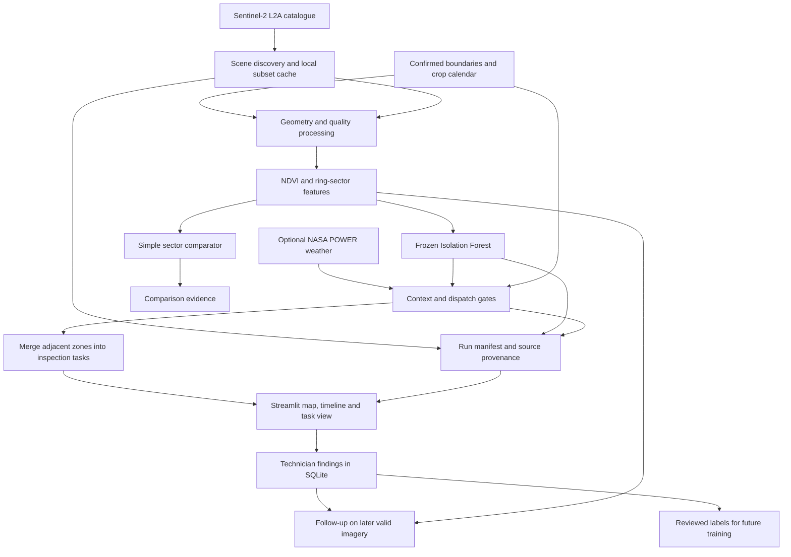

# PivotWatch architecture and data pipeline

Prepared 7 October 2026. The original presentation architecture and future implementation blueprint, now accompanied by a runnable synthetic-data local MVP. The current app demonstrates a bounded replay, Isolation Forest ranking, basic quality/history/persistence gates, a technician workflow, local SQLite records, and exports. Real Sentinel-2 processing and field validation remain future work; see [MVP documentation](MVP.md). Read alongside [presentation narrative](presentation_outline.md), [data acquisition](data_acquisition.md), [model selection](model_selection.md), and the [solution statement](solution_statement.md).

**Target architecture:** a Python batch pipeline connected to an inspection interface. The target implementation caches satellite subsets, computes crop features by pivot ring and sector, fits Isolation Forest, and turns persistent anomalies into traceable inspection tasks. SQLite holds workflow records; GeoTIFF and Parquet hold imagery and features. The current MVP implements only the synthetic feature/model/workflow slice; it has no raster catalog or processing modules yet. The presentation can explain the complete target flow with the diagram and a labeled illustrative case.

## System design



All demo services run in one process or as local batch commands. The interface reads completed run artifacts and invokes ordinary Python functions; it does not download imagery on every page refresh. Model training is an explicit offline operation. A later hosted version can reuse the same processing functions behind FastAPI, a job worker, object storage and PostgreSQL/PostGIS.

| Component | Responsibility | Proposed tools / artifact |
|---|---|---|
| Discovery | Query intersecting scenes, paginate, retain metadata and select acquisitions | `pystac-client`, provider adapter, STAC JSON |
| Raster processing | Read only field windows, normalize reflectance, mask and align | `rasterio`, NumPy; local GeoTIFF |
| Geometry | Validate boundaries, calculate metric distances and create analysis zones | GeoPandas, Shapely, pyproj; GeoJSON |
| Feature builder | Produce one record per zone per valid acquisition | pandas; Parquet |
| Training / inference | Fit development data once; score later observations consistently | scikit-learn; model artifact plus metadata |
| Decision service | Apply quality, context, freshness and persistence gates; deduplicate tasks | Plain Python with versioned configuration |
| Inspection interface | Show ranked tasks, imagery dates, observations, alternatives and findings | Streamlit; local rendered map overlay and charts |
| Workflow storage | Store tasks, inspection events and follow-up without rewriting model evidence | SQLite |
| Evidence export | Reproduce an output from exact inputs and settings | Manifest JSON, CSV and GeoJSON exports |

## Processing sequence

1. **Register a pivot.** Import a WGS84 polygon and center, crop, season, planting date, crop-stage information and operations. Mark unverified values explicitly. Check polygon validity and that the center is plausible. Work in the local metric CRS; the proposed Wadi search region lies in UTM zone 38N, EPSG:32638. Keep longitude/latitude for exports.
2. **Discover history.** Search a completed crop-season window for a small cluster of pivots. Start with 3–5 fields and seek 12–20 usable acquisition dates. Eight development dates plus two later evaluation dates are the minimum inherited availability gate; where possible reserve additional development dates for threshold calibration. These counts do not establish independent sample size or statistical reliability.
3. **Cache subsets.** Retrieve B04 and B08 for analysis, B02/B03 for RGB display, and SCL for quality. Retain source item IDs, acquisition times, processing baseline, scale/offset, grid, source asset reference and file checksum. Deduplicate overlapping tiles or repeated processing versions; two tiles from one acquisition cannot count as two persistence observations.
4. **Normalize and align.** Apply the provider's documented reflectance conversion once, honoring nodata. Lock all dates to the same 10 m grid and spatial extent. Resample categorical SCL with nearest neighbor; do not bilinearly interpolate classes. Inspect cross-date alignment and processing-baseline changes before treating change as crop behavior. [Sentinel-2 processing documentation](https://documentation.dataspace.copernicus.eu/APIs/SentinelHub/Data/S2L2A.html).
5. **Apply quality masks.** Exclude nodata, defective pixels, cloud shadows, clouds, cirrus, snow/ice, water and uncertain SCL classes. A conservative initial policy retains SCL 4 and 5 within the supplied crop footprint, with a small configurable cloud buffer and one-pixel field-edge erosion. Keeping class 5 avoids hiding exposed soil in stressed zones. This policy needs visual review; SCL cannot guarantee dust-free or cloud-free evidence. Freeze the expected crop footprint for the season instead of removing low-NDVI pixels dynamically.
6. **Build polar zones.** Begin with 12 sectors and 4 equal-area radial bands. For radius R, ring boundaries are R × sqrt(k/4), k=0…4. Clip these to the actual field footprint and merge cells that cannot meet the valid-pixel minimum. Define 0° as north, bearings increasing clockwise. Preserve physical radii in meters. Field corners, missing wedges and access tracks remain excluded.
7. **Calculate features.** NDVI = (B08 − B04)/(B08 + B04), after reflectance conversion; near-zero denominators become invalid. Aggregate the valid pixels per cell, preserving coverage. Calculate the features below using only information available by that acquisition date. Do not interpolate across clouds to manufacture evidence of persistence.
8. **Fit and score.** Fit an Isolation Forest on development observations of comparable crop stages. Save the feature ordering, seed, training IDs and threshold. Score the held-out period without refitting. Run the simple comparator on identical inputs and eligibility gates. Detailed model choices are in [model selection](model_selection.md).
9. **Gate recommendations.** Apply the explicit rules below. An eligible unusual zone first becomes a candidate. A recurring spatially overlapping anomaly can become an inspection recommendation after the persistence gate. Merge connected zones; cap the displayed queue at a configurable three tasks per pivot per round. A cap never forces the system to fill the queue.
10. **Record and revisit.** Save what the technician measured, found and changed, separately from the model prediction. On later usable dates, compare the same area with its earlier state and peers. Label this observed post-action change; it does not prove causation or water savings.

## Feature contract

| Feature | Definition / use |
|---|---|
| `ndvi_median` | Median valid NDVI in the cell |
| `peer_deficit` | Median of comparable peer cells minus this cell's NDVI; positive means relatively lower vegetation index |
| `temporal_change_per_day` | Current minus preceding valid cell NDVI, divided by elapsed days; also store the gap |
| `radial_deficit` | Adjacent radial bands in the same sector minus the current cell |
| `angular_deficit` | Adjacent sectors in the same band minus the current cell |
| `declining_neighbor_fraction` | Fraction of valid adjacent cells with a negative temporal change; null when no valid neighbors exist |
| `field_change_per_day` | Change in field-wide median, retained separately for broad-decline routing |

Use the first six as the initial candidate model features, subject to feature availability. Keep quality, dates, crop stage and operation flags as explicit decision context. A missing temporal or spatial feature makes a cell ineligible for that model version; never fill it with zero. Compare entire rings with other rings as well as local neighbors. Keep whole-field decline as a separate review condition because within-field contrast can erase it.

## Recommendation contract

These are proposed engineering defaults carried forward from the solution, not validated agronomic thresholds.

| Gate | Requirement | Otherwise |
|---|---|---|
| Geometry / context | Confirmed geometry and comparable crop-stage context; no unresolved operation explanation | Exploratory review, with missing context shown |
| Quality | At least 80% valid pixels of the fixed eligible cell footprint and at least 30 valid native 10 m pixels | `insufficient_quality` |
| History | At least eight usable development dates for the configured cohort and sufficient prior data for the cell features | `insufficient_history` |
| Anomaly | Score exceeds a frozen development threshold and observed direction supports a deficit or decline | No local inspection candidate |
| Persistence | Two distinct anomalous acquisitions at the same/overlapping location, at most 20 days apart | `pending_persistence` |
| Freshness | Latest acquisition no more than 15 days before the analysis clock | `stale_observation` |
| Management | No recorded operation sufficiently explains the pattern; unknown records remain visible | Explained operation or context review |

Run modes are `live` and `historical_replay`. Live mode uses today's date. Replay uses an explicit historical analysis date shown prominently throughout the interface and exports; its outputs are simulated historical recommendations and cannot enter a live dispatch queue. This makes the freshness gate meaningful even with cached 2025 imagery.

Persist all gate outcomes and their reason codes. Insufficient evidence must remain visible rather than disappearing as a normal field. An anomaly score is neither a fault probability nor a diagnosis. Inspection wording comes from the explicit decision table in the solution statement.

## Storage contracts

| Entity | Required fields |
|---|---|
| `pivots` | `pivot_id`, boundary, center, CRS, geometry version, crop, season, planting date, context verification |
| `operations` | `operation_id`, pivot, affected geometry, type, occurred-at time, recorded-at time, source |
| `observations` | `observation_id`, item IDs, acquisition time, provider, processing baseline, asset checksums, grid, mask version |
| `zone_features` | observation, pivot, geometry version, zone, pixel counts, valid fraction, feature values, feature version |
| `model_runs` | `run_id`, model hash, configuration hash, input IDs, fit cutoff, evaluation IDs, analysis clock, run mode |
| `tasks` | `task_id`, run, affected polygon, radius/bearing range, supporting observation IDs, score, gate results, requested check, status |
| `inspection_events` | task, actor, timestamp, measurement value and unit, finding, action, supporting evidence, `is_synthetic` |
| `followups` | task, later observation IDs, change metrics, evidence quality, resolution state |

Use acquisition and recorded-at timestamps to prevent hindsight leakage during replay: an operation entered later was not available to the historical decision. Keep model predictions immutable; add workflow events separately. Enforce foreign keys and transactional writes. Never serialize a displayed score as a calibrated probability.

## Target implementation layout

This tree describes the intended real-data pipeline. The existing local MVP modules and run instructions are listed in [MVP documentation](MVP.md); the raster and catalog modules below have not been implemented.

```text
app.py                       # inspection interface
configs/demo.yaml            # cohort, window, gates, model settings
src/pivotwatch/
  catalog.py                 # STAC discovery and provider adapters
  raster.py                  # local cache, normalization, masks, alignment
  geometry.py                # boundary checks and polar zones
  features.py                # causal temporal/spatial feature builder
  model.py                   # fit, artifact load and score
  decisions.py               # gates, grouping and diagnostic questions
  storage.py                 # SQLite workflow operations
  pipeline.py                # deterministic batch orchestration
data/raw/                    # source subsets and metadata
data/processed/              # aligned indices and feature tables
artifacts/models/            # model, threshold and training manifest
artifacts/runs/<run_id>/     # complete evidence bundle
```

Key callable boundaries: `discover(aoi, window)`, `prepare(scene, grid)`, `features(pivot, observations_as_of)`, `fit(development_features)`, `score(frozen_model, features)`, and `recommend(scores, context_as_of, analysis_clock)`. UI code calls these services without duplicating decision logic. Cache keys include source version, geometry, preprocessing and feature versions; reruns with identical inputs must not duplicate tasks. Save artifacts atomically, record errors per scene and retry transient downloads with bounded backoff.

## Future prototype build order and acceptance

| Order | Deliverable | Acceptance evidence |
|---|---|---|
| 1 | One confirmed field boundary plus cached real acquisitions | RGB/NDVI alignment and source manifest |
| 2 | Quality processing and zone feature table | Valid coverage shown for each acquisition |
| 3 | Fitted model and comparator | Saved development/evaluation split, model and both score outputs |
| 4 | Inspection view and feedback | Select zone → see dated evidence → record finding → reopen saved record |
| 5 | Failure and replay cases | Stale, cloudy, harvest and insufficient-history inputs withhold the appropriate recommendation |
| 6 | Optional pretrained model extension | Only after the core run is reproducible; see model decision |

Show a real time series even if it contains no verified fault. If a reliable anomaly example is unavailable, add a separate labeled synthetic perturbation fixture and synthetic technician finding. Never attach a fabricated finding to a real farm as observed truth. Synthetic examples establish software behavior only.

The final demonstration bundle should contain input metadata, cropped imagery, configuration, feature table, model version, comparator results, gate outcomes, task export and a short recording. Actual fault precision/recall requires independent field labels; source access and attractive maps alone cannot provide those metrics.
