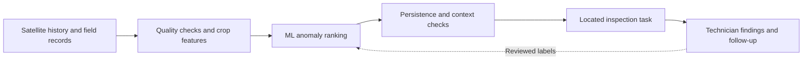

# PivotWatch: presentation-ready technical narrative

Prepared 7 October 2026. The original presentation plan preceded implementation of the local MVP. The app now provides an optional synthetic-data workflow demo; it does not provide real satellite analysis or validated farm findings. Use these four slides within the broader problem/solution pitch, and consult [MVP documentation](MVP.md) before deciding whether to demonstrate the app. [Detailed architecture](architecture.md) · [Data sources](data_acquisition.md) · [Model decision](model_selection.md).

## Slide 1 — From satellite observation to a field inspection

**Main message:** PivotWatch proposes a traceable way to prioritize persistent crop anomalies for inspection.

Speaker note: “We combine dated satellite observations with pivot geometry and crop records. The model ranks unusual crop patterns. Quality and persistence checks control the inspection queue. A technician then records the cause and action, creating evidence for follow-up and future model improvement.”

Use a small caption: **Proposed architecture; field performance has not yet been measured.**

## Slide 2 — The data pipeline preserves where and when a change happened

| Stage | What happens | What reaches the next stage |
|---|---|---|
| Acquire | Retrieve Sentinel-2 L2A history and import field boundary/calendar | Dated imagery plus field context |
| Prepare | Correct reflectance handling, align dates, mask unusable pixels | Comparable valid observations |
| Describe | Compute NDVI; summarize pivot rings and sectors | Local deficit, temporal change and spatial contrast |
| Rank | Fit Isolation Forest to comparable historical observations | Unusual zones ranked for review |
| Decide | Check coverage, repeated evidence, data age and operations | Inspection task or explicit insufficient-evidence state |
| Learn | Record technician findings and later observations | Reviewed outcomes for future training |

Speaker note: “A low vegetation index can have several causes. Our output specifies where to inspect and what to check, while preserving observation dates and alternative explanations.”

Diagram callouts can show **80% valid coverage**, **two anomalous observations within 20 days**, and **latest observation within 15 days**. Label these **initial engineering settings to validate**, not established agronomic thresholds. Keep detailed preprocessing and database choices in backup material.

## Slide 3 — Where we acquire data

| Data | Source | Current evidence |
|---|---|---|
| Satellite reflectance and cloud mask | Copernicus Sentinel-2 via Planetary Computer or Copernicus Data Space | Public catalogue query returned candidate scenes for the Wadi Al-Dawasir search area |
| Field center, boundary, crop and operations | Farm operator; manually reviewed geometry for an illustration | Partner and crop context still to be confirmed |
| Weather context | NASA POWER | Documented public API; optional regional context |
| Confirmed fault and action labels | Technician records and prospective field inspections | Must be collected; a suitable public Saudi fault dataset was not identified |

Speaker note: “Access to satellite imagery is feasible: we queried the catalogue and received real scene records. The critical missing data are confirmed local inspection outcomes, which we would collect with a farm partner.”

Evidence callout: **29 April 2025 — Sentinel-2 L2A, tile T38QNH, catalogue scene cloud cover 0%.** This verifies a catalogue record; it does not verify a potato field, usable pixels over that field, or an irrigation fault. Detailed item IDs and the reproducible query are in the [acquisition guide](data_acquisition.md).

Source footer: [Planetary Computer access](https://planetarycomputer.microsoft.com/docs/concepts/sas/), [Sentinel-2 data](https://dataspace.copernicus.eu/data-collections/copernicus-sentinel-missions/sentinel-2), [NASA POWER](https://power.larc.nasa.gov/docs/services/api/temporal/daily/).

## Slide 4 — Model choice follows the available labels

| Role | Choice | Reason |
|---|---|---|
| Proposed initial model | Isolation Forest | Learns unusual spatial/temporal feature combinations without requiring verified fault classes |
| Future fine-tuning candidate | Prithvi-EO-2.0-tiny-TL | Small pretrained EO backbone to evaluate after reviewed local examples exist |
| Existing fine-tuned reference | Prithvi-EO-1.0 crop-classification checkpoint | Demonstrates available satellite transfer-learning assets; its class set does not include potato or equipment faults |

Speaker note: “Our first model is fitted on local feature history. We would consider fine-tuning an EO backbone after collecting reviewed examples. An existing crop classifier cannot supply missing physical-fault labels.”

Source footer: [Isolation Forest](https://scikit-learn.org/stable/modules/generated/sklearn.ensemble.IsolationForest.html), [Prithvi tiny](https://huggingface.co/ibm-nasa-geospatial/Prithvi-EO-2.0-tiny-TL), [fine-tuned crop model](https://huggingface.co/ibm-nasa-geospatial/Prithvi-EO-1.0-100M-multi-temporal-crop-classification).

## Optional illustrative walkthrough

Use the constructed sector example already in [solution_statement.md](solution_statement.md): one sector falls from NDVI 0.72 to 0.42 while the other eleven remain at 0.72. Its field average remains 0.695. Explain how local features preserve the change, then show a proposed inspection packet and feedback record.

Place **Illustrative inputs; not a trained-model result or verified fault** beside the example. Do not display an invented anomaly score, measured accuracy, or real technician finding. Any interface illustration should be labeled **concept screen**.

## Backup answers

| Judge's question | Answer |
|---|---|
| Has the model been trained? | No. This presentation provides the proposed design and source research; training and field evaluation are planned. |
| What has been checked? | Model/data documentation and a successful public catalogue query returning Saudi-area scene metadata. |
| Why not use an existing fine-tuned fault detector? | This review did not identify a checkpoint validated for the target Saudi task. Available crop and irrigation-method models answer different questions. |
| What proves the fault? | A field inspection and relevant measurements; satellite observations establish a candidate pattern. |
| How will you evaluate it? | Compare the model with a simple sector baseline and inspect both alerted and unalerted zones; measure actionability and decision/search time. |
| What does presentation-only mean for the rubric? | Architecture and feasibility can be explained, but executable development and measured validation cannot be claimed. |

For this presentation, replace the live-demo segment in the earlier pitch guide with the labeled walkthrough. Leave implementation milestones as future work. No checkpoint download, GPU reservation, or cloud deployment is required to prepare these slides.
